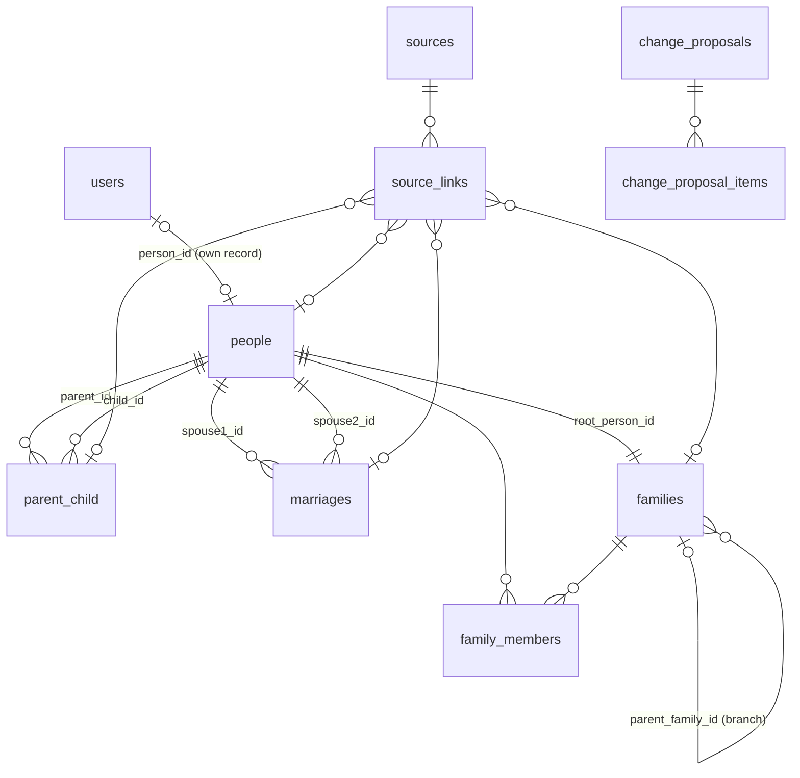

# Database reference

PostgreSQL 15+ (developed on 18; Supabase compatible). Migrations live in
`database/migrations/` and are the only way the schema changes.

## Genealogy model



| Table | Purpose |
|---|---|
| `people` | One canonical record per human. Never duplicated to place someone in another tree. |
| `parent_child` | Directed edge, typed `biological` / `adoptive` / `foster`, with certainty. |
| `marriages` | Edge between two people. Any number per person, concurrent or sequential, with status `ongoing / separated / divorced / widowed / annulled / unknown`, fuzzy start/end dates and recorded order ("2nd wife"). |
| `families` | A lineage rooted at its earliest known ancestor; optional `parent_family_id` for a branch (bari) of a larger clan. |
| `family_members` | Explicit membership (`lineage`, `marriage`, `adoption`, `other`); one primary family per person. |
| `sources`, `source_links` | Citations (oral history, documents, graves, land records...) attached to exactly one person, family, parent-child edge or marriage. |
| `change_proposals`, `change_proposal_items` | Reviewed, atomic edit requests from members. |
| `audit_logs` | Append-only log of every insert/update/delete, written by triggers. |

### Rules enforced by the database

| Rule | Mechanism | Error |
|---|---|---|
| Nobody is their own parent | CHECK `parent_child_not_self` | 23514 |
| No duplicate parent→child edge | UNIQUE `parent_child_unique` | 23505 |
| No circular ancestry (any depth, any path) | trigger, recursive walk, serialised with an advisory lock | `VH001` |
| At most two biological parents | trigger | `VH002` |
| Parent and spouse of the same person can't both hold | triggers on both tables | `VH003` |
| Merged-away (duplicate) records can't get new relationships | trigger | `VH004` |
| Two biological parents can't share a recorded sex | trigger | `VH005` |
| Family root can't be removed from its family | trigger | `VH006` |
| No self-marriage | CHECK | 23514 |
| One non-dissolved marriage per couple (remarriage after divorce/annulment allowed) | partial unique index | 23505 |
| End date only on ended marriages; end not before start | CHECK | 23514 |
| Death implies deceased; death not before birth | CHECK | 23514 |
| One lineage per root person; one primary family per person | UNIQUE | 23505 |
| Only admins change roles, change a moderator's or admin's status, or delete accounts (when `app.user_id` is set) | trigger on `users` | `VH101` |
| At least one verified admin always remains | trigger on `users` | `VH102` |
| Audit log can't be edited or deleted | trigger | `VH900` |

Deleting a person who still has relationships fails (`ON DELETE RESTRICT`, 23001);
relationships must be removed explicitly (through a proposal).

### Children grouped by spouse

There is deliberately **no** `marriage_id` on `parent_child`. A child is linked
only to their actual parents, and their grouping under a spouse is derived:

```sql
SELECT * FROM person_children_by_coparent(:person_id);
-- child_id | relationship_type | co_parent_id | co_parent_relationship_type | marriage_id
```

* `co_parent_id` is the child's other parent (NULL means unknown, so the child is shown under the person alone).
* `marriage_id` is the marriage between the two parents, if one is recorded.

Because the grouping comes from the parent records, a child can't be attached
to the wrong wife or husband, and adding a spouse never assigns them children.

### Repeated ancestors

Cousin marriages mean the same ancestor can be reached by several paths. Every
traversal uses `UNION` (or path tracking) and de-duplicates, so it terminates
and returns each ancestor once.

## Historical dates: `fuzzy_date`

A composite domain `(qualifier, year, month, day, year_to, month_to, day_to)`:

| Meaning | Value | JSON |
|---|---|---|
| unknown | `NULL` | `null` |
| in 1920 | `make_fuzzy_date('exact', 1920)` | `{"qualifier":"exact","year":1920}` |
| 16 Dec 1971 | `make_fuzzy_date('exact', 1971, 12, 16)` | `{"qualifier":"exact","year":1971,"month":12,"day":16}` |
| around 1880 | `make_fuzzy_date('about', 1880)` | `{"qualifier":"about","year":1880}` |
| before 1900 / after 1947 | `make_fuzzy_date('before', 1900)` | `{"qualifier":"before","year":1900}` |
| between 1880 and 1885 | `make_fuzzy_date('between', 1880, NULL, NULL, 1885)` | `{"qualifier":"between","year":1880,"year_to":1885}` |

Month and day are never invented. Helpers: `fuzzy_date_from_jsonb`,
`fuzzy_date_to_jsonb`, `fuzzy_date_sort_key` (sorting only), `fuzzy_date_range`
(plausible span; *about* = ±10 years), and `fuzzy_dates_may_be_ordered`.
In SQL, read fields with `(birth).year`.

## Privacy

`people.privacy_level` is NULL by default, which means automatic:
`effective_privacy` is `members` for deceased people and `restricted` for living
or unknown-status people. Levels:

* `public`: visible without login
* `members`: verified members
* `family`: members of the person's families
* `restricted`: the person themself, moderators, admins

## Who can change genealogy

There are no per-family roles. Verified **moderators and admins** edit any family
tree directly and review all change proposals (`user_has_role(user, 'moderator')`).
Members submit change proposals; `change_proposals.family_id` only records which
family a proposal concerns, so moderators can filter by it. Migration 0006 removed
the original `family_managers` table.

The API redacts personal details (dates, places, photo, biography) by
`effective_privacy`. Names and tree positions stay visible to verified members so
trees remain navigable.

## Audit context

The API runs each write in a transaction and first sets:

```sql
SELECT set_config('app.user_id', $1, true),
       set_config('app.proposal_id', $2, true),   -- when applying a proposal
       set_config('app.request_id', $3, true);
```

Triggers copy these into every `audit_logs` row together with old/new row data
and the list of changed fields.

## Running

```bash
cp .env.example .env            # set DATABASE_URL and TEST_DATABASE_URL
npm install
npm run db:migrate              # apply migrations
npm run db:status               # list applied/pending
npm run db:seed                 # FICTIONAL sample genealogy (refused when NODE_ENV=production)
npm run db:test                 # wipes and rebuilds the *_test database, runs all DB tests
```

Never edit a migration that has been applied anywhere. Add a new numbered file instead;
the runner refuses to continue if an applied file's checksum changes.
